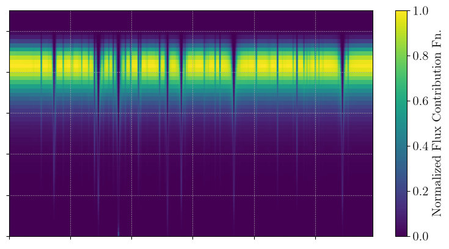
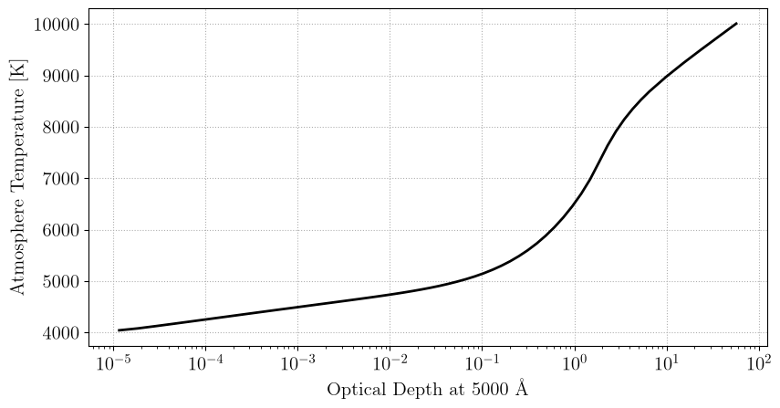
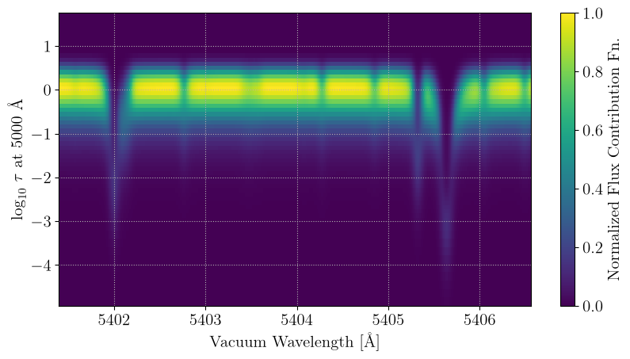
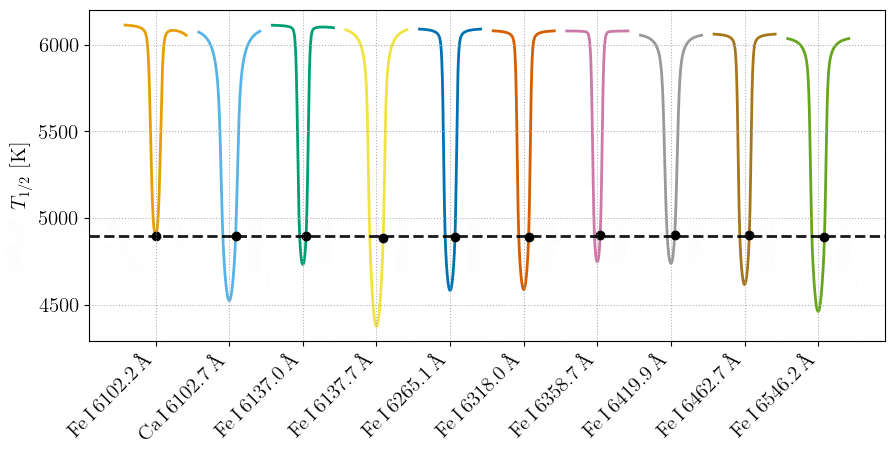
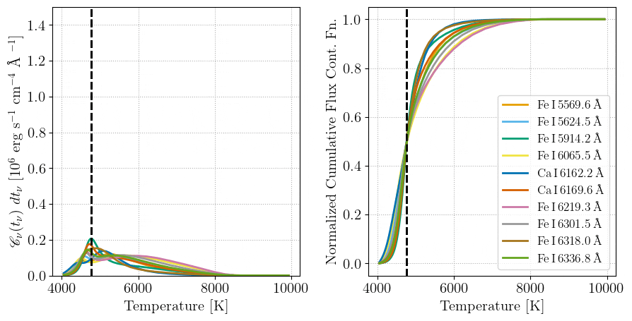

# Manipulating Contribution Functions

Formation temperatures are a summary statistic of the contribution functions, which
```FormTempResult``` also carries in its ```cont_func``` field. To plot them:

```@eval
using Markdown
code = read(joinpath(pwd(), "examples", "cont_func.jl"), String)
break_marker = "# BREAK1"
stop_idx = findfirst(break_marker, code)
code = stop_idx === nothing ? code : code[1:prevind(code, stop_idx.start)]
Markdown.parse("```julia\n" * code * "\n```")
```


## Integrals or densities?

Element `[k, j]` of ```cont_func``` is the contribution of the atmosphere interval between layers
`k` and `k+1` to the flux at wavelength `j`. Summing a column gives the emergent flux, in the
units of `Korg.synthesize` and on the same scale for every `method`; `result.flux` is that sum
divided by the continuum sum:

```julia
sum(result.cont_func, dims=1)   # the emergent flux
```

Each element already includes the width of its interval, so:

- **For sums over depth**, use ```cont_func``` as it is. Weighted means, cumulative
  distributions and the 50% crossing behind ```form_temps_from_cfunc``` are all of this kind.
- **For comparisons across depth**, such as plotting against depth or taking a ratio of two
  intervals, convert to a density with ```cfunc_per_dex```, which gives `dF/dlog₁₀τ_ref`.
  MARCS layers are 0.1 dex apart in log τ_ref between −3 and +1 and 0.2 dex outside, so raw
  ```cont_func``` jumps by a factor of two at those depths for no physical reason. The plots on
  this page use the density, and ```ceiling_ratio``` converts internally, which is why it needs
  `τ_ref`.

To label the depth axis, take the atmosphere structure from the result:

```@eval
using Markdown
code = read(joinpath(pwd(), "examples", "cont_func.jl"), String)
start_marker = "# BREAK1"
end_marker = "# BREAK2"
start_idx = findfirst(start_marker, code)
end_idx = findfirst(end_marker, code)
if start_idx !== nothing && end_idx !== nothing && start_idx.start < end_idx.start
    start_nl = findnext('\n', code, start_idx.start)
    slice_start = start_nl === nothing ? lastindex(code) + 1 : nextind(code, start_nl)
    slice_end = prevind(code, end_idx.start)
    code = slice_start <= slice_end ? code[slice_start:slice_end] : ""
end
Markdown.parse("```julia\n" * code * "\n```")
```


Zoomed in on a few lines, with the depth axis labeled:

```@eval
using Markdown
code = read(joinpath(pwd(), "examples", "cont_func.jl"), String)
start_marker = "# BREAK2"
end_marker = "# BREAK3"
start_idx = findfirst(start_marker, code)
end_idx = findfirst(end_marker, code)
if start_idx !== nothing && end_idx !== nothing && start_idx.start < end_idx.start
    start_nl = findnext('\n', code, start_idx.start)
    slice_start = start_nl === nothing ? lastindex(code) + 1 : nextind(code, start_nl)
    slice_end = prevind(code, end_idx.start)
    code = slice_start <= slice_end ? code[slice_start:slice_end] : ""
end
Markdown.parse("```julia\n" * code * "\n```")
```


## Formation temperatures can lie to you!

Pixels with the same formation temperature need not have similar contribution functions. In
each frame below, the black pixels in the line cores share a formation temperature to within a
couple of Kelvin, yet their contribution functions differ markedly. They converge toward the
continuum, but most of the radial-velocity information sits in the steep line flanks, where
they do not. Sections 4.2 and 4.3 of the
[paper presenting FormationTemps.jl](https://ui.adsabs.harvard.edu/abs/2025arXiv251209861P/abstract)
discuss this further; read them before relying on formation temperatures.




## Lines the model cannot get right

```boundary_mask``` only catches lines whose contribution function has not decayed by the top
of the model atmosphere. It cannot catch a line whose physics is wrong: Korg assumes LTE and
MARCS has no chromosphere, so a chromospheric line, a line far from LTE, or one with poor
atomic data gives a well-behaved contribution function and a meaningless formation
temperature.

The repo carries a curated list of such lines in `data/bad_lines.csv`, applied by
`scripts/bad_lines_mask.jl`. Each row gives an air wavelength (`lambda_air`), a species and a
reason: `chromo`, `nlte` or `linedata`.

```julia
using FormationTemps; FT = FormationTemps
include(joinpath(FT.moddir, "scripts", "bad_lines_mask.jl"))

entries = read_bad_lines(joinpath(FT.datdir, "bad_lines.csv");
                         vacuum=true, max_extent_default=MAX_EXTENT_DEFAULT)
entries = verify_species_present(entries, line_wavs, line_species;
                                 n_sigma_halo=N_SIGMA_HALO, v_broad=v_broad)

lm = build_line_mask(result.wavs, result.flux, entries;
                     n_sigma_halo=N_SIGMA_HALO, depth_thresh=DEPTH_THRESH,
                     min_core_depth=MIN_CORE_DEPTH, v_broad=v_broad,
                     core_frac=CORE_FRAC)
```

`line_wavs` and `line_species` come from the linelist the synthesis used, and
`v_broad = sqrt(vsini^2 + ζ^2 + ξ^2)`.

!!! note "Packages the script loads"
    The script loads CSV, DataFrames and Korg. Outside the FormationTemps project, add them to
    your environment first:

    ```julia
    using Pkg; Pkg.add(["CSV", "DataFrames", "Korg"])
    ```

The line mask uses bits `0x02`, `0x04` and `0x08` for the three reasons and leaves `0x01` for
the boundary flag, so the two combine into one array:

```julia
bnd = ifelse.(boundary_mask(result), MASK_BOUNDARY, 0x00)
mask = lm.mask .| bnd
good = mask .== 0x00
```

Each entry masks the line's own core: ```build_line_mask``` starts at the flux minimum near the
listed wavelength and widens until the line rises back above
`max(DEPTH_THRESH, CORE_FRAC · core_depth)`. ```report_line_mask``` prints the region each entry
settled on.

```verify_species_present``` drops, with a warning, any entry whose species has no nearby line
in the linelist. Without it, an entry for a missing transition would mask whatever unrelated
line happened to be deepest nearby.

This is a script, not package API: the list is data you can inspect and amend.
