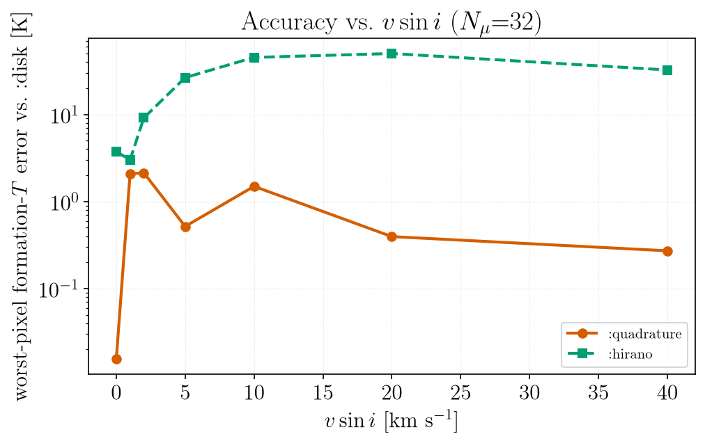
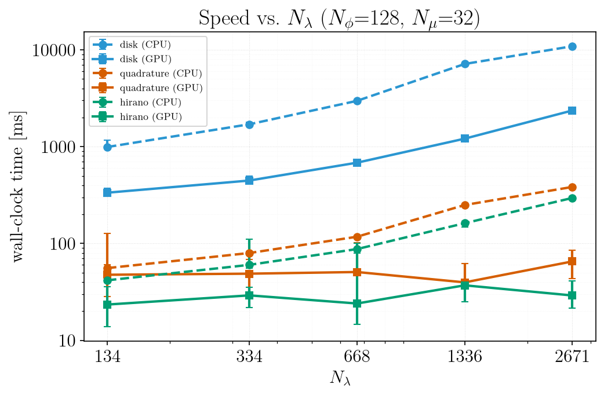
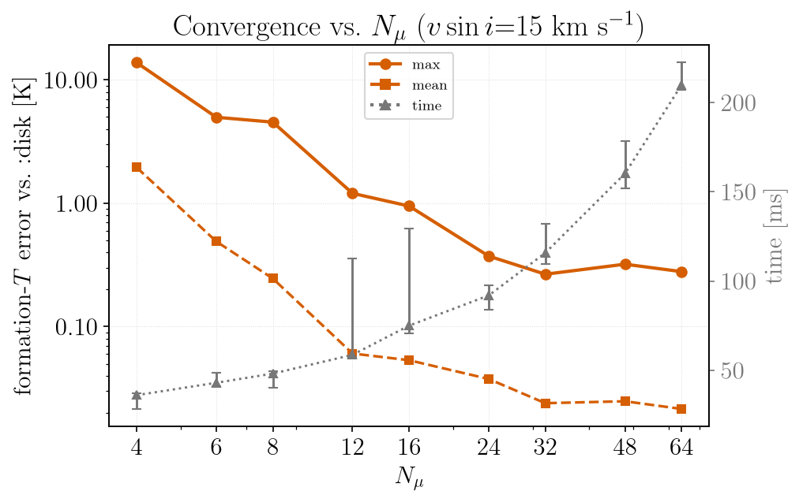
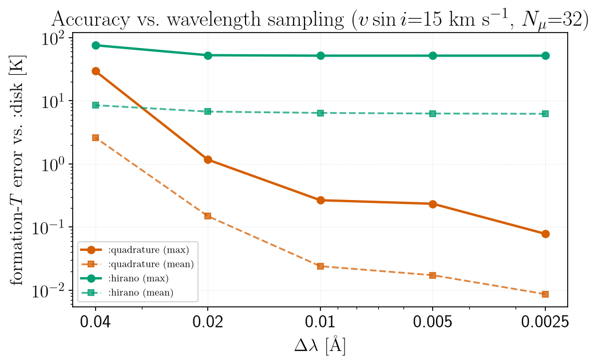

# Integration Methods

```@meta
CurrentModule = FormationTemps
```

`calc_formation_temp` can integrate over the stellar disk in three ways, selected with
the `method` keyword:

| `method` | description | worst-pixel error vs `:disk` | cost |
|----------|-------------|-----------------------------|------|
| `:disk` (default) | explicit integration over `Nϕ` latitude bins | reference | seconds per call |
| `:quadrature` | Gauss–Legendre μ-quadrature, rotation applied per ring | ≲ 2 K | 18–28× less than `:disk` on CPU, 7–36× on GPU |
| `:hirano` | analytic rotation + macroturbulence kernel (needs `u1`, `u2`) | tens of K once `vsini ≳ 5` km/s | 1.3–1.5× less than `:quadrature` on CPU, 1–2× on GPU |

```julia
calc_formation_temp(star, linelist; method=:disk)                      # reference
calc_formation_temp(star, linelist; method=:quadrature)                # fast, near-reference
calc_formation_temp(star, linelist; method=:hirano, u1=0.43, u2=0.31)  # fastest, approximate
```

All three run on the GPU with `use_gpu=true`.

!!! note "`convolve` is a deprecated alias"
    `convolve=false` maps to `method=:disk` and `convolve=true` to `method=:hirano`.
    New code should use `method`.

## Which method to use

- **`:disk` is the reference.** It is the most accurate and the most expensive. Use it for
  the definitive answer, or to check the other two.
- **`:quadrature` is the right choice almost everywhere else.** It reproduces `:disk`,
  inclination and differential rotation included, to within about 2 K at the worst pixel and
  well under 0.1 K on average, for a twentieth to a thirtieth of the CPU time.
  `gpu_precision=Float32` costs it no accuracy.
- **`:hirano` trades a lot of accuracy for a little speed.** It is only 1.3–1.5× faster than
  `:quadrature` on CPU, and on a GPU both finish in tens of milliseconds. Its error, tens of
  Kelvin once `vsini ≳ 5` km/s, comes from its parametric limb darkening and does not shrink
  with resolution. Use it only when cost matters more than that.



Worst-pixel formation-temperature error against `:disk`. `:quadrature` is least accurate around
`vsini ≈ 1–2` km/s, where its rotation kernel spans only a few wavelength pixels.



Wall-clock time per call (`Nϕ = 128`, `Nμ = 32`) on the machine described under
[Parallelization](@ref); error bars span repeated timings.

## Tuning `:quadrature`

The defaults are converged, so there is rarely a reason to change them.

- **`Nμ`**: more nodes than the default of 32 cost time without improving agreement.

  

- **`Δλ`** is the setting to refine for agreement better than about 0.3 K: the remaining error
  comes from placing the rotation kernel on the wavelength grid. `:hirano` does not improve
  with finer sampling.

  

- **`N_az`** only matters under differential rotation, and then by millikelvin. Leave it alone.

The figures are regenerated by `benchmarks/benchmark_quadrature.jl` followed by
`benchmarks/plot_quadrature.jl`.

## Rotation

Rotation is set by `vsini` (the projected equatorial velocity), `istar`, and the
differential-rotation coefficients `α₂`, `α₄` on [`StellarProps`](@ref). For rigid rotation
`istar` has no effect. `:hirano` supports rigid rotation only.

## Caveats

- **Saturated line cores.** Where the contribution function still peaks at the top of the
  model atmosphere, the formation temperature is set by where the model was truncated and is a
  lower limit. [`boundary_mask`](@ref) flags those wavelengths; drop them before interpreting
  a formation-temperature spectrum:

  ```julia
  result = calc_formation_temp(star, linelist)
  good = .!boundary_mask(result)          # or boundary_mask(result; r_thresh=…)
  ```

  A line can also be wrong for reasons the contribution function does not show, such as LTE
  or bad atomic data; see [Lines the model cannot get right](@ref "Lines the model cannot get right").

- **Narrow windows.** If the rotation kernel is wider than the wavelength window,
  `:quadrature` warns that the broadening is truncated. Widen the window with `minλ`/`maxλ`.
