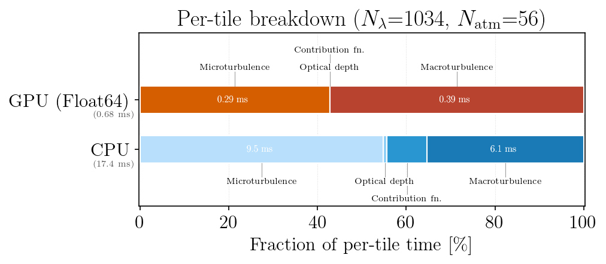
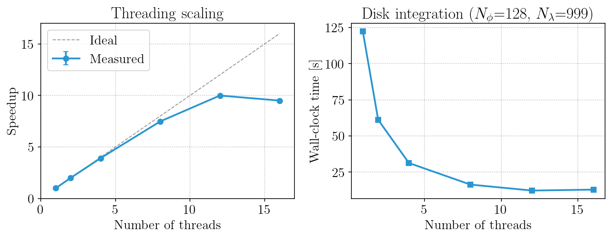
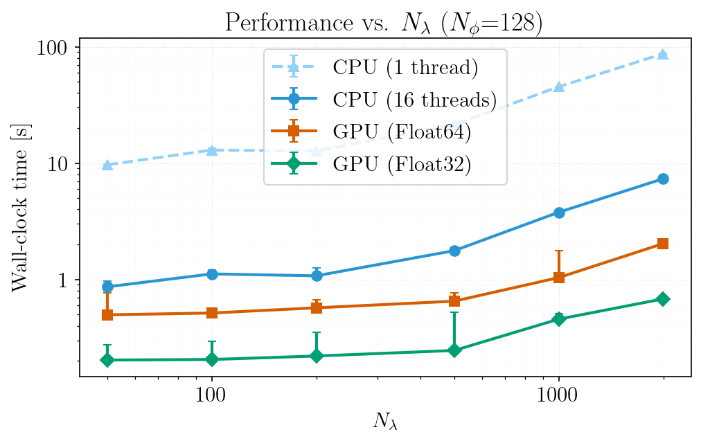
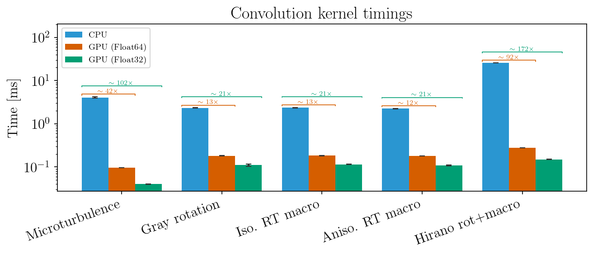
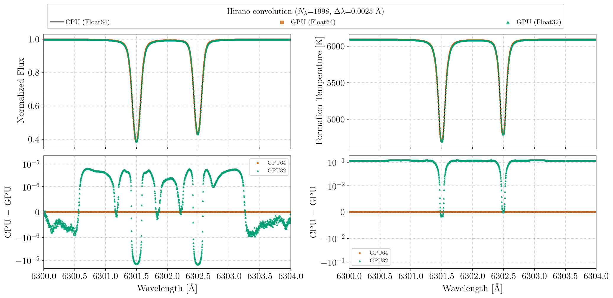
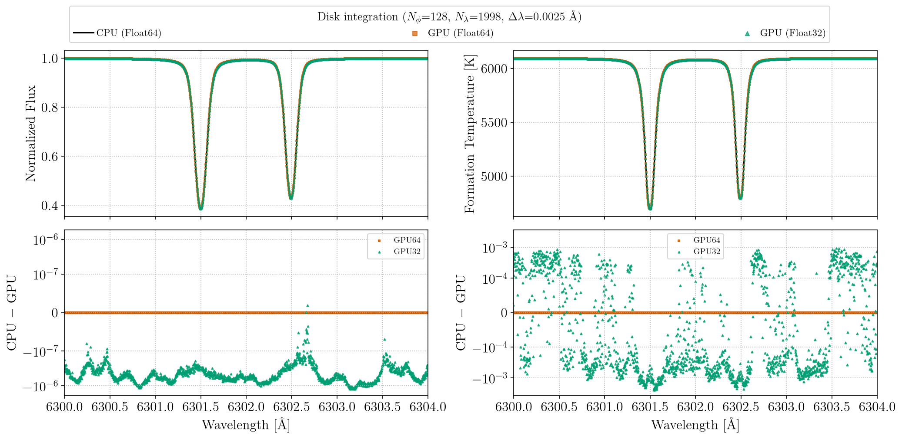

# Parallelization

```@meta
CurrentModule = FormationTemps
```

FormationTemps.jl can use CPU threads and an NVIDIA GPU. What each speeds up depends on the
[integration method](@ref "Integration Methods"):

| `method` | CPU threads | GPU |
|---|---|---|
| `:disk` | surface tiles run in parallel | yes |
| `:quadrature` | absorption calculation only | yes |
| `:hirano` | absorption calculation only | yes |

`:disk` is the method that needs parallel hardware most. `:quadrature` is fast enough that the
absorption calculation is often the largest part of a call.

## CPU multithreading

Start Julia with several threads:

```bash
julia -t auto           # all available cores
julia -t 8              # 8 threads
```

or set `JULIA_NUM_THREADS` before launching. `:disk` on the CPU scales well to about 16
threads (about 12× at 16).

!!! warning "Python interoperability"
    Multithreading is not compatible with calling FormationTemps.jl from Python through
    juliacall: it can crash the process. Set `JULIA_NUM_THREADS=1` when calling from Python,
    and use the GPU or `method=:quadrature` for speed instead. See the
    [Python Tutorial](@ref "Python Tutorial").

## GPU acceleration

The GPU is used by default when a working NVIDIA device is found (`CUDA.functional() == true`);
pass `use_gpu=false` to force the CPU. To check your setup:

```julia
using CUDA
CUDA.functional()   # should return true
CUDA.versioninfo()  # device and toolkit details
```

If `CUDA.functional()` returns `false`, see the
[CUDA.jl troubleshooting guide](https://cuda.juliagpu.org/stable/installation/troubleshooting/);
FormationTemps.jl falls back to the CPU.

### Precision

```julia
result = calc_formation_temp(star, linelist; gpu_precision=Float32)
```

`gpu_precision=Float32` roughly halves GPU memory and can be faster on consumer GPUs. Absorption
is always computed at Float64 and converted. The cost in accuracy is small (see
[below](@ref "Float32 vs. Float64 accuracy")). The default is `Float64`.

## Benchmarks

Measured on an Intel Xeon w5-3435X (16 cores / 32 threads) with an NVIDIA RTX 6000 Ada (48 GB),
for two Fe I lines near 6300 Å with solar parameters (`vsini = 2100` m/s, `ζ = 3500` m/s,
`ξ = 850` m/s) and `Nϕ = 128`. Regenerate everything with
`julia --project=. -t auto benchmarks/run_all.jl`.

### Cost per surface tile (`:disk`)



### CPU thread scaling (`:disk`)



### Performance vs. wavelength grid size (`:disk`)



### Broadening kernels

Time per broadening kernel on CPU and GPU.



## Tips

- **GPU memory.** Each call allocates its GPU buffers. If memory is tight, use
  `gpu_precision=Float32`.
- **Large linelists.** The absorption calculation runs on the CPU for every method and grows
  with the number of lines × `Nλ`. For large linelists it can dominate the total time, GPU or
  not; see [Large Linelists](@ref "Large Linelists & Chunked Synthesis").

## Float32 vs. Float64 accuracy

On the CPU and the GPU at Float64 the results agree to rounding. At Float32 the GPU results
differ from the CPU by about 10⁻⁶ in flux and a few mK in formation temperature with `:disk`,
and by about 10⁻⁵ and 0.1 K with `:hirano`. The figures show both, for two Fe I lines near
6300 Å; the bottom rows are residuals against the CPU at Float64.




